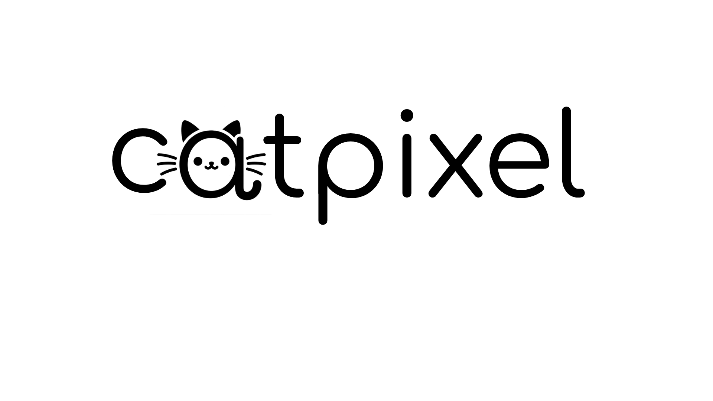

<p align="center">
  
</p>

<h1 align="center">CatPixel</h1>

<p align="center">
  Processador de imagens com interface gráfica, feito em Python.<br>
  Todos os algoritmos são implementados do zero, manipulando diretamente a matriz da imagem.
</p>

> **Status:** em desenvolvimento. A leitura/gravação de imagens e a limiarização estão prontas. A interface gráfica e os demais algoritmos ainda não foram implementados (veja o [Roadmap](#roadmap)).

## Sumário

- [Sobre o projeto](#sobre-o-projeto)
- [Funcionalidades](#funcionalidades)
- [Roadmap](#roadmap)
- [Primeiros passos](#primeiros-passos)
- [Uso](#uso)
- [Testes](#testes)
- [Estrutura do projeto](#estrutura-do-projeto)
- [Regras do projeto](#regras-do-projeto)
- [Contribuindo](#contribuindo)
- [Licença](#licença)

## Sobre o projeto

O CatPixel é um trabalho da disciplina de Processamento de Imagens. O objetivo é um programa com interface gráfica simples, para que uma pessoa sem experiência edite imagens salvas no próprio computador.

A cada aula entra um novo conjunto de algoritmos, que a equipe implementa e adiciona ao programa.

## Funcionalidades

Legenda: ✅ pronto · 🚧 em andamento · ⬜ pendente

### Base

| Funcionalidade | Status |
| --- | --- |
| Abrir imagens (BMP, JPG) | ✅ |
| Salvar imagens (BMP, JPG) | ✅ |
| Interface gráfica | ⬜ |

### Trabalho 1 — Operações pontuais, histograma e convolução

| Funcionalidade | Status |
| --- | --- |
| Limiarização | ✅ |
| Negativo | ⬜ |
| Brilho | ⬜ |
| Potência (correção de gama) | ⬜ |
| Linear definida por partes | ⬜ |
| Esteganografia | ⬜ |
| Exibição do histograma | ⬜ |
| Equalização de histograma | ⬜ |
| Filtro genérico por convolução (3x3 até, no mínimo, 9x9, mesmo tamanho da original) | ⬜ |

### Filtros espaciais

| Funcionalidade | Status |
| --- | --- |
| Suavização pela média (simples e ponderada/Gaussiana) | ⬜ |
| Filtro da mediana | ⬜ |
| Aguçamento por Laplaciano | ⬜ |
| Aguçamento High-Boost | ⬜ |
| Sobel X e Y (com normalização para exibição) | ⬜ |
| Detecção de bordas pela magnitude do gradiente | ⬜ |

### Transformações geométricas

| Funcionalidade | Status |
| --- | --- |
| Escala (vizinho mais próximo e bilinear) | ⬜ |
| Rotação (vizinho mais próximo e bilinear) | ⬜ |
| Rotação com pivô especificado | ⬜ |

### Domínio da frequência

| Funcionalidade | Status |
| --- | --- |
| Transformada Discreta de Fourier (própria) | ⬜ |
| Transformada Rápida (FFT) | ⬜ |
| Espectro deslocado com edição pelo usuário (pincel preto, branco e suave) | ⬜ |
| Transformada inversa a partir do espectro editado | ⬜ |

### Imagens coloridas

| Funcionalidade | Status |
| --- | --- |
| Conversão RGB ↔ HSI | ⬜ |
| Escala de cinza (média simples e ponderada) | ⬜ |
| Negativo colorido | ⬜ |
| Chroma-Key (distância da cor verde e imagem substituta ajustáveis) | ⬜ |
| Histogramas R, G, B e I | ⬜ |
| Equalização de histograma colorida (HSI) | ⬜ |
| Ajuste de matiz, saturação e brilho | ⬜ |
| Ajuste de canal (C/R, M/G, Y/B) | ⬜ |
| Sépia | ⬜ |
| Demais processamentos funcionando em imagens coloridas | ⬜ |

> **Nota:** hoje o `load_image` converte toda imagem para escala de cinza (matriz 2D). Para as etapas coloridas, ele precisa passar a devolver `(H, W, 3)`.

## Roadmap

1. ✅ Entrada e saída de imagens
2. ✅ Limiarização
3. ⬜ Demais operações pontuais (negativo, brilho, gama, linear por partes)
4. ⬜ Histograma e equalização
5. ⬜ Convolução genérica e filtros espaciais
6. ⬜ Escala e rotação com interpolação
7. ⬜ Esteganografia
8. ⬜ Fourier e edição do espectro
9. ⬜ Imagens coloridas (HSI, chroma-key, sépia etc.)
10. ⬜ Interface gráfica integrando tudo

## Primeiros passos

### Pré-requisitos

- Python 3.10 ou superior
- `pip`

### Instalação

```bash
git clone <url-do-repositorio>
cd catpixel

python3 -m venv .venv
source .venv/bin/activate

pip install numpy pillow
```

> O projeto ainda não tem `requirements.txt`. As dependências usadas até agora são `numpy` e `Pillow`.

## Uso

A interface gráfica ainda não existe (`main.py` está vazio). Por enquanto, os módulos de `model/` podem ser usados direto em Python:

```python
from model.image_io import load_image, save_image
from model.thresholding import threshold_image

imagem = load_image("imagens/GatoHalloween.jpg")   # matriz 2D uint8 (H, W)
binaria = threshold_image(imagem, 128)             # pixels >= 128 viram 255, os demais 0
save_image(binaria, "saida.bmp")
```

Salve a imagem limiarizada em BMP. O JPG comprime com perdas e cria tons de cinza nas bordas.

## Testes

Os testes são scripts. Rode-os a partir da raiz do projeto:

```bash
python -m tests.test_io
python -m tests.test_thresholding
```

`test_thresholding` grava os arquivos `saida_limiar_*.bmp` no diretório atual.

## Estrutura do projeto

O projeto segue a separação MVC:

```
catpixel/
├── main.py              # ponto de entrada (ainda vazio)
├── model/               # algoritmos de processamento
│   ├── image_io.py      # abrir e salvar imagens
│   └── thresholding.py  # limiarização
├── view/                # interface gráfica (a implementar)
├── controller/          # liga a interface aos algoritmos (a implementar)
├── tests/               # scripts de teste
├── imagens/             # imagens de exemplo e saídas de teste
├── LogoJPG.jpg
└── LogoPNG.png
```

## Regras do projeto

- O Pillow é usado **somente** para abrir e salvar arquivos.
- Nenhuma biblioteca de processamento de imagens pode ser usada nos algoritmos. Eles manipulam a matriz da imagem diretamente.
- Bibliotecas de álgebra linear (como o NumPy) são permitidas, mas não suas funções que sejam, elas próprias, requisito do trabalho.
- Se a DFT for implementada de forma ingênua, o programa também deve oferecer uma FFT de biblioteca, para que imagens grandes sejam viáveis.
- Ao exibir o resultado de filtros que geram valores negativos ou acima de 255, normalize os valores apenas para exibição.

## Contribuindo

1. Faça um fork do repositório.
2. Crie uma branch: `git checkout -b feature/minha-funcionalidade`
3. Faça o commit: `git commit -m "Adiciona minha funcionalidade"`
4. Envie a branch: `git push origin feature/minha-funcionalidade`
5. Abra um Pull Request.

Coloque novos algoritmos em `model/` e o teste correspondente em `tests/`.

## Licença

Ainda não definida. Antes de publicar o projeto como open source, adicione um arquivo `LICENSE`, por exemplo MIT.
